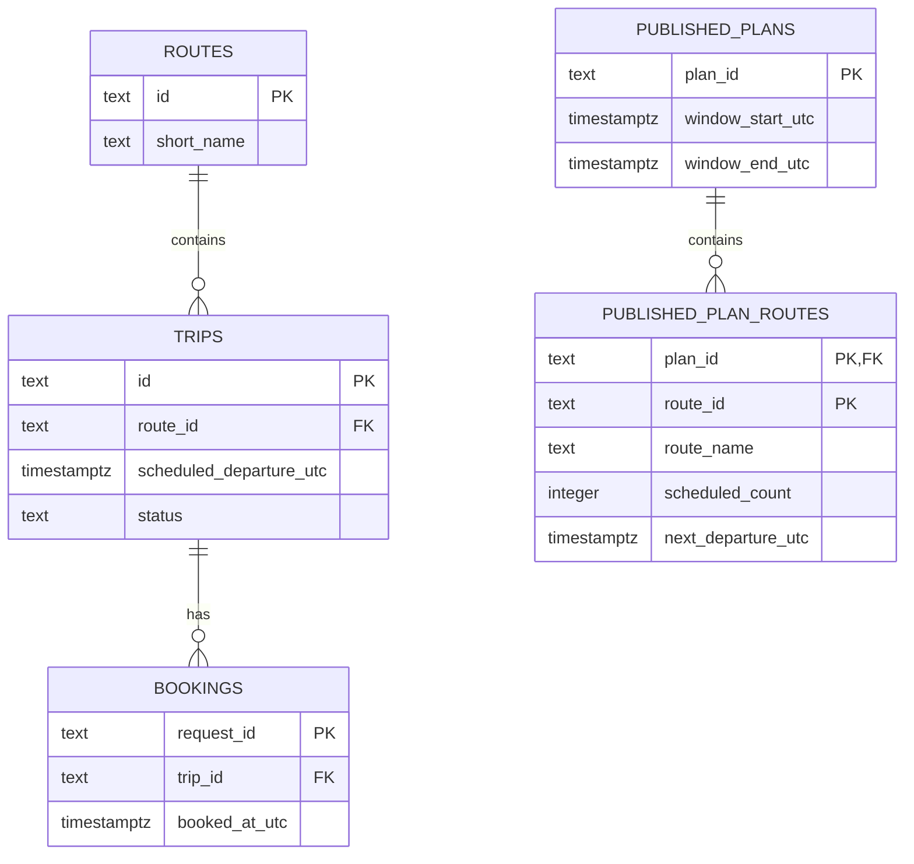
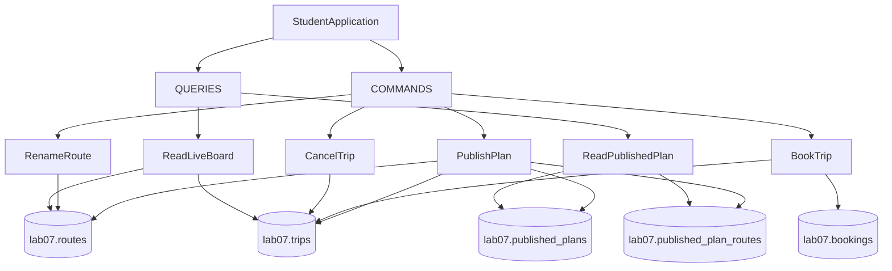

# Design decision

Add your sketch of the command/query paths and the tables they use.

Compare two designs in about 150 words. Explain your choice, what a cancellation
would update, and how a published plan keeps its original values. Mark the
transaction boundaries for booking and publication.

Doodles:
# ER-diagram (database structure)
De er indsat som mermaid-diagrammer i `docs/design.md`. De viser vores Command/Query Paths og de tabeller, de bruger. Vi har separate tabeller for Routes, Trips, Bookings og Published Plans. Vores Live Board henter data on-demand fra Routes og Trips, mens Published Plans gemmer snapshots af de oprindelige værdier i separate tabeller.

# Command/Query-diagram (application flow) 

Vi sammenlignede to forskellige designs: at beregne vores Live Route Overview on-demand og at vedligeholde en separat Current-Summary Table.

Vi valgte On-Demand Calculation med EF Core Projection, fordi vores Departure Board altid skal vise de aktuelle route-navne, antal scheduled trips og næste afgang inden for et vilkårligt UTC-tidsvindue. Når en trip bliver cancelled, eller en route bliver renamed, opdateres vores Source Tables, så efterfølgende queries automatisk viser ændringerne.

En Current-Summary Table kunne forbedre performance ved gentagne queries, men ville kræve ekstra Synchronization, især når vi arbejder med forskellige tidsvinduer.

Til vores Live Board foretrækker vi at bruge Projection direkte til RouteOverviewDto frem for at benytte Eager Loading med Include, hvor vi indlæser komplette Route- og Trip-entities. Projection reducerer unødvendig Data Transfer og Object Materialization, samtidig med at vi kan udføre Aggregation direkte i SQL.

Vores Published Plans benytter separate, persistente Snapshot Tables, så de oprindelige værdier bevares, selvom data senere ændres.

På Command-siden håndterer vi Booking Rules, Idempotency, Retries og Transactional Consistency. Vi benytter desuden Database Constraints og passende Concurrency Control for at forhindre duplicate requests og inkonsistente databaseændringer.

